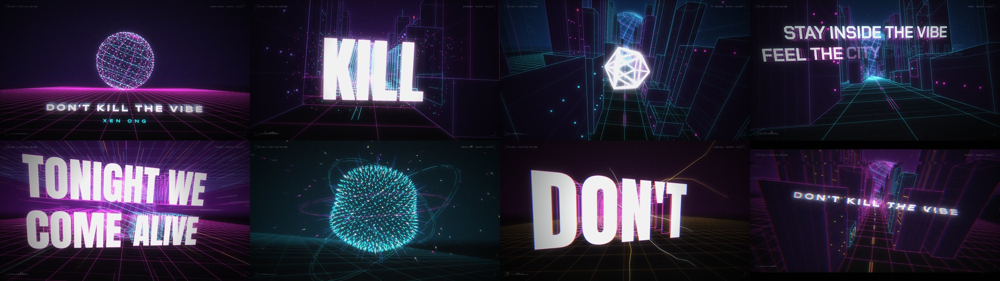

# Don't Kill the Vibe：用代码生成的 3D 音乐 MV



这支 3 分 42 秒的 MV 没有拍摄，也没有用 3D 软件或 AE。画面里的每一栋楼、每一条隧道、每一个粒子和每一句立体歌词，都是代码一帧一帧画出来，再用 FFmpeg 编码成 MP4 的。镜头推进、闪光、建筑高度全部由歌曲的节拍和频谱驱动。

- 音乐：Mureka V9.5
- 歌词：Xen Ong × Claude
- 画面代码：Claude Fable 5.2
- 作者：**Xen Ong（风子）**

> 想让 AI 帮你改这套代码、换成你自己的歌？把 [`AGENTS.md`](AGENTS.md) 交给你的 AI 助手（Claude Code、Codex、Cursor 等），它会知道整个项目怎么运作、该改哪里。

---

## 流程总览

| 步骤 | 做什么 | 工具 |
|---|---|---|
| 1. 做音乐 | 生成带人声的歌 | Mureka（或任何 AI 音乐工具） |
| 2. 对歌词时间 | 每个字唱在第几秒 | faster-whisper + `tools/align_lyrics.py` |
| 3. 分析节奏 | 节拍、每帧的低/中/高频能量 | librosa |
| 4. 写画面 | 按段落设计 3D 场景 | `scenes.mjs`（交给 AI 改） |
| 5. 看静帧 | 先抽几张关键帧检查 | `npm run stills` |
| 6. 渲染出片 | 分段渲染 → 拼接 → 合音频 | `tools/render_all.sh` |

## 环境

- Node.js 18 以上
- Python 3.10 以上
- FFmpeg（命令行里能直接跑 `ffmpeg`）

```bash
npm install
pip install -r requirements.txt
```

**不需要显卡**，全部用 CPU 渲染。实测 8 核云端机器渲染 1080p 全片约 12 分钟；一般笔电会慢几倍，可以先用小尺寸测试。

## 一步一步做

### 1. 准备歌曲

把你的歌放到 `data/song.wav`。

本仓库**不附带原曲音频**，AI 音乐能不能公开分发，要看你用的平台和订阅方案。

我的做法：先用 Mureka V8 做一首纯音乐，把音频交给 AI 分析速度、调性和结构，让它写 Mureka 的风格提示词和押韵歌词，再用 Mureka V9.5 生成人声版。

### 2. 歌词时间轴

把标准歌词写进 `data/lyrics.txt`。段落标题用 `[Chorus]` 这种格式；一句唱了几次，就写几次。

```bash
python tools/transcribe.py      # 识别人声，得到每个词的时间（第一次会下载约 500MB 模型）
python tools/align_lyrics.py    # 以你的歌词为准对齐，输出 data/lyrics.json
python tools/preview.py         # 生成 data/preview.html，双击打开边听边对
```

标着 `ESTIMATED` 的句子是 whisper 没听清的，要人工确认。大声喊的副歌和重复段落最容易漏。只重新识别那一段，再手动把时间填进 `data/lyrics.json`：

```bash
python tools/transcribe.py --from 150 --to 165
```

### 3. 节拍和能量

```bash
python tools/beats.py     # data/beats.json：BPM 和每一拍的时间
python tools/energy.py    # data/energy.json：每帧的低/中/高频能量和频谱
```

`energy.py` 会打印一张每 2 秒一格的响度图，还会列出静音的位置，用来判断段落从哪里切换。

### 4. 改画面

所有场景都在 `scenes.mjs` 里。换歌时最少要改三个地方：

1. **`T`**：每个段落的开始时间，按你的歌改；
2. **`SP`**：镜头前进速度曲线（高潮快、间奏慢）；
3. **`pick()`**：每个时间段用哪个场景，里面还有少量写死的秒数。

片名、署名、右上角的 BPM 文字在 `hud()`、`scIntro()`、`scOutro()`、`scCredits()` 里。

不会写代码也没关系：把 `AGENTS.md`、你的 `data/lyrics.json` 和 `energy.py` 打印出来的响度图一起交给 AI，说清楚你要的感觉，让它来改。

### 5. 先看静帧

```bash
npm run stills
# 或指定时间点：
node render.mjs --stills 12.5,48,127.3 --outdir stills
```

每张静帧就是成片里那一帧的样子。先在这一步把画面调满意，再出全片。

### 6. 渲染全片

```bash
npm run render              # 横屏 1920×1080 → out/1920x1080/
npm run render:vertical     # 竖屏 1080×1920 → out/1080x1920/
```

会输出两个文件：

- `final.mp4`：母版，码率高、文件大；
- `share.mp4`：约 10 Mbps，适合上传和分享。

全片会被切成每 28 秒一段来渲染。只改了某个场景的话，删掉对应的 `pNN.mp4` 再跑一次就行，其他段落会直接沿用。

## 文件结构

```
engine.mjs        3D 线框渲染器：相机、投影、文字转 3D、霓虹辉光、色差、故障效果
scenes.mjs        全部场景、歌词动画、段落时间表（换歌主要改这里）
render.mjs        逐帧渲染：输出 MP4 片段或 JPG 静帧
tools/
  transcribe.py   faster-whisper 识别人声的逐词时间
  align_lyrics.py 把标准歌词对齐到识别结果
  preview.py      生成字幕预览网页，边听边检查
  beats.py        节拍检测
  energy.py       每帧频段能量和频谱
  render_all.sh   并行分段渲染、拼接、合音频
  sheet.sh        把多张静帧拼成一张总览图
data/
  lyrics.txt      标准歌词（示例）
  lyrics.json     本曲对好的时间轴（示例）
  beats.json      本曲的节拍（示例）
```

## 授权

- 代码：MIT License，可以自由使用、修改、商用，保留署名即可。
- 字体：通过 npm 安装 Fontsource 的开源字体（SIL Open Font License）。
- 歌曲音频不包含在本仓库里。
